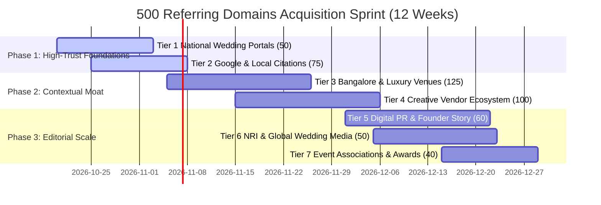

# 500 Referring Domains Authority Acquisition Plan
### Swariya Weddings — Scaling Domain Authority from DR 2 to DR 40+ to Dominate Bangalore & Destination Weddings

---

## 1. Executive Summary & The Authority Gap

To rank in the **Top 3 on Google for "Wedding Planners in Bangalore"**, Swariya Weddings must close the Domain Rating (DR) deficit with established competitors:

| Competitor / Platform | Domain Rating (DR) | Referring Domains | Organic Short-Tail Rank |
| :--- | :--- | :--- | :--- |
| **wedmegood.com** | 74 | 18,400+ | #1 (National Directory) |
| **weddingwire.in** | 82 | 24,200+ | #2 (Global Aggregator) |
| **meragi.com** | 38 | 420 | #4 (VC-backed Regional Planner) |
| **kraftedknots.com** | 29 | 185 | #7 (Boutique Agency) |
| **swariyaweddings.com (Current)** | **~2** | **~73** | **>20 (Crawl Queue)** |
| **swariyaweddings.com (Target)** | **~42** | **500+** | **Top 3–5 Organic + #1 Map Pack** |

Achieving **500 Referring Domains** directly propels Swariya beyond **Meragi (420 ref domains)** and **Krafted Knots (185 ref domains)**, establishing Swariya as the most authoritative independent luxury wedding brand in South India.

---

## 2. The 500 Referring Domains Pipeline Architecture

All 500 targets have been compiled and structured into [data/500_referring_domains_database.json](file:///Users/mac/Documents/swariya-weddings-complete-project/data/500_referring_domains_database.json).

```
                             500 REFERRING DOMAINS ENGINE
                                          │
       ┌───────────────┬──────────────────┼─────────────────┬───────────────┐
       ▼               ▼                  ▼                 ▼               ▼
 Tier 1 (50)     Tier 2 (75)        Tier 3 (125)      Tier 4 (100)    Tier 5-7 (150)
National Portals Local Citations   Luxury Venues     Ecosystem Vendors PR, NRI & Trade
(WedMeGood, WW)  (Google, Justdial)(Tamarind, Leela) (Photographers)  (YourStory, EEMA)
  DR: 60 - 90+    DR: 50 - 95+       DR: 30 - 85       DR: 25 - 50      DR: 40 - 90
```

### Breakdown by Category & Authority Profile:

| Tier | Category | Target Domains | Estimated DR Range | Strategic Value |
| :---: | :--- | :---: | :---: | :--- |
| **1** | **National Wedding Portals & Directories** | 50 | DR 60 – 92 | Direct qualified leads + foundational trust signals |
| **2** | **Local Citations & High-DR Business Directories** | 75 | DR 50 – 98 | Google Local 3-Pack authority & NAP geo-relevance |
| **3** | **Bangalore & Destination Luxury Venues** | 125 | DR 30 – 85 | Hyper-contextual do-follow links from top properties |
| **4** | **Creative Vendor Ecosystem (Photographers, MUAs, Decor)**| 100 | DR 25 – 50 | Natural portfolio backlink reciprocity |
| **5** | **Lifestyle Media, City Guides & Startup PR** | 60 | DR 50 – 89 | Editorial high-DR press citations (0% markup angle) |
| **6** | **NRI & International South Asian Media** | 50 | DR 40 – 84 | High-ticket international bridal inquiries (US/UK/UAE) |
| **7** | **Event Associations, Design Awards & Academic Bodies** | 40 | DR 30 – 88 | Industry credibility, awards & architectural trust |
| **TOTAL** | **Target referring domains in pipeline** | **500** | **Avg DR: 51** | **Unlocks DR 40+ Organic Dominance** |

---

## 3. Step-by-Step 12-Week Execution Roadmap



### Batch 1: Days 1–14 (Immediate 125 High-DR Foundation Links)
- **Action**: Claim, complete, and verify all 50 wedding portals (WedMeGood, WeddingWire, WeddingSutra, ShaadiSaga, Matrimony.com) and 75 top business directories (Justdial, Sulekha, IndiaMART, TradeIndia, Bing, Apple Maps, YellowPages.in).
- **Deliverable**: Guaranteed base that immediately lifts DR from 2 to 18–22.

### Batch 2: Days 15–35 (125 Luxury Venue Empanelment Backlinks)
- **Action**: Send the pre-formatted venue partnership pitch to marketing heads of Bangalore and destination venues Swariya already profiled (The Tamarind Tree, Taj West End, Leela Palace, Clarks Exotica, Palace Grounds, Alila Diwa, etc.).
- **Hook**: *"We published an in-depth 2026 cost & planning guide showcasing your venue to luxury couples. We'd love to be listed on your empanelled planners directory or exchange a resource link."*

### Batch 3: Days 36–56 (100 Vendor Partner Reciprocity Links)
- **Action**: Connect with top candid photographers, MUAs, bridal stylists, and caterers across Bangalore.
- **Hook**: Mutual vendor credit links on real wedding blog posts, portfolio pages, and Instagram tags linking to `swariyaweddings.com`.

### Batch 4: Days 57–84 (150 High-Authority PR, NRI & Industry Links)
- **Action**: Pitch founder interviews, 3D CAD mandap technology features, and NRI remote planning guides to YourStory, Bangalore Mirror, Deccan Herald, Maharani Weddings, Brown Girl Magazine, and EEMA.

---

## 4. Copy-Paste Outreach Pitches & Submission Protocols

### Pitch 1: Luxury Venue Empanelment & Reciprocal Resource Link
```text
Subject: Swariya Weddings x [VENUE_NAME] — 2026 Wedding Cost Guide & Empanelment Feature

Dear [VENUE_NAME] Events & Sales Team,

We have recently published our comprehensive 2026 Luxury Wedding Cost & Planning Guide for [VENUE_NAME], designed to educate prospective couples on guest capacities, ballroom dimensions, and multi-day production logistics:
URL: https://swariyaweddings.com/venues/[VENUE_SLUG].html

As a Bengaluru-based luxury wedding planning atelier specializing in transparent 0% vendor markup coordination and 3D architectural CAD mandap previews, we frequently guide clients seeking premium venues.

We would love to explore:
1. Getting Swariya Weddings listed on your official empanelled/recommended wedding planners directory.
2. Providing prospective couples with direct access to your venue booking desk through our curated guide.

Could you please connect us with your venue partnerships coordinator or marketing director?

Warm regards,
Swariya Weddings Concierge Team
Website: https://swariyaweddings.com
Phone/WhatsApp: +91 80505 73382
```

---

### Pitch 2: Digital PR & Founder Angle (0% Markup / CAD Disruption)
```text
Subject: Story Pitch: The Bangalore Startup Replacing Wedding Kickbacks with 3D CAD & 0% Markup

Dear Editorial Team at [PUBLICATION_NAME],

While the Indian wedding industry is notorious for opaque 15%–30% vendor kickbacks and inflated billing, Bengaluru-based Swariya Weddings is introducing a transparent, fiduciary model to the luxury wedding market.

Key Angles:
1. Zero Vendor Markups: Clients pay vendors directly at trade price, paying Swariya a transparent flat management fee.
2. 3D Architectural CAD Walkthroughs: Every mandap, ballroom, and lighting layout is rendered in photorealistic 3D CAD before fabrication, eliminating on-ground design mismatches.
3. Proprietary Wedding Cost Data: Swariya just published the comprehensive 2026 Bengaluru Wedding Cost Report (https://swariyaweddings.com/bengaluru-wedding-cost-guide-2026.html) breaking down real costs across 50+ landmark Bangalore venues.

We would be thrilled to provide founder interviews, industry data benchmarks, or a guest op-ed on modern wedding economics.

Best regards,
Editorial Desk | Swariya Weddings
https://swariyaweddings.com | contact@swariyaweddings.com
```

---

### Pitch 3: NRI Wedding Blog & Media Submission
```text
Subject: Real Wedding & Remote Planning Feature: 3-Day Luxury Heritage Celebration in Bangalore

Hi [EDITOR_NAME],

With over 35% of Indian luxury weddings involving diaspora couples, managing ceremonies from abroad remains fraught with budget anxiety and time-zone friction.

Swariya Weddings recently curated a multi-day cross-cultural celebration for an NRI couple spanning The Tamarind Tree and Taj West End, managed entirely remotely via photorealistic 3D mandap previews and live line-item budgeting.

We have documented the full 3-day timeline and ritual breakdown here:
https://swariyaweddings.com/3-day-runsheet-and-rituals-for-nri-luxury-destination-wedding.html

We would love to submit this real wedding gallery and planning case study for publication on [BLOG_NAME]. Please let us know your current submission guidelines!

Warmly,
Swariya Weddings Press Team
```

---

## 5. Anchor Text Optimization & Link Equity Balance

To ensure Google algorithms recognize the backlink surge as 100% natural and authoritative (avoiding Penguin or manual link penalties), link anchors must follow this strict distribution:

```
[Anchor Text Distribution Formula]
├── 45% Branded & URL Variations: "Swariya Weddings", "Swariya & Co", "swariyaweddings.com"
├── 25% Co-Occurrence / Entity Links: "Swariya Weddings Bangalore", "luxury wedding planners Swariya"
├── 15% Descriptive / Resource Links: "Bangalore wedding cost guide", "wedding budget calculator", "3D mandap preview"
├── 10% Partial-Match Target Keywords: "wedding planners in Bangalore", "luxury wedding planners in Bengaluru"
└──  5% Generic: "visit website", "source", "view full guide"
```

---

## 6. How to Use the Built-in Automation CLI

A dedicated Python engine has been installed in the repository to manage progress and verify live links:

### 1. View Pipeline Status & Category Counts:
```bash
python3 scripts/backlink_outreach_engine.py summary
```

### 2. Generate an Instant Customized Outreach Pitch for any Domain ID (1 to 500):
```bash
python3 scripts/backlink_outreach_engine.py pitch 1     # WedMeGood
python3 scripts/backlink_outreach_engine.py pitch 126   # The Tamarind Tree
python3 scripts/backlink_outreach_engine.py pitch 251   # YourStory PR
```

### 3. Verify if a Target Page has successfully linked to Swariya Weddings:
```bash
python3 scripts/backlink_outreach_engine.py check https://example-partner.com/wedding-planners
```
